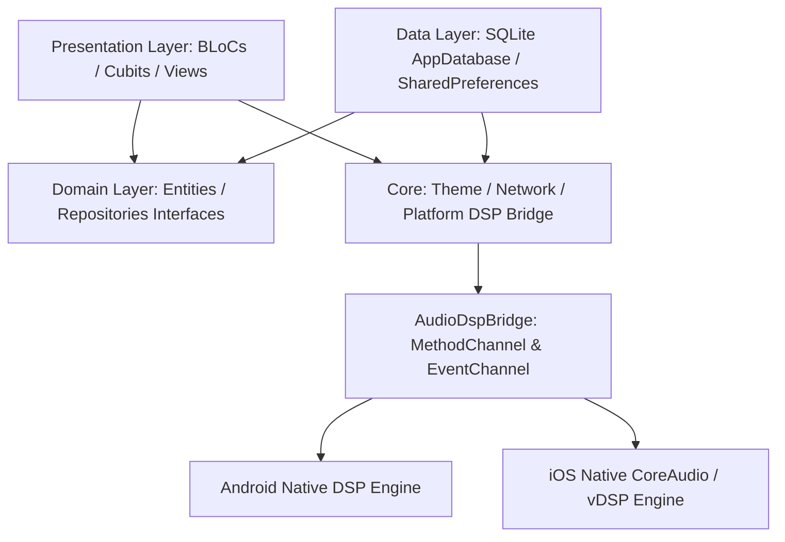
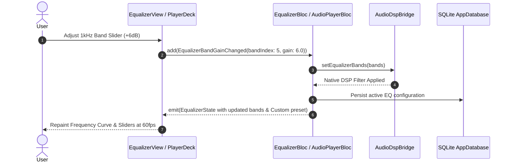
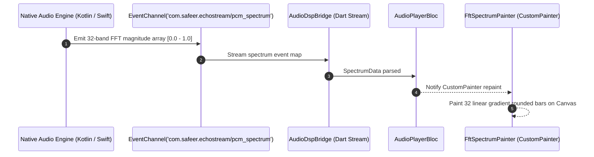

# EchoStream - Lossless Spatial Audio Streaming Platform

[](https://github.com/Safeer-Hussain/echostream/actions/workflows/ci.yml)
[](https://flutter.dev)
[](https://dart.dev)
[](https://bloclibrary.dev)
[](LICENSE)

EchoStream is a flagship Lossless Spatial Audio Streaming Platform, Live Interactive Podcast & Audio Room Studio, Native 10-Band Hardware DSP Equalizer Bridge, Offline Media Vault, and On-Device AI Transcript Copilot engineered in Flutter.

---

## Architectural Highlights

- **Lossless Audio Streaming Engine:** Low-latency playback clock, synchronized chapter scrubbing, timestamp bookmarks, and variable playback speeds (0.5x - 2.5x).
- **Native 10-Band Hardware DSP Bridge:** MethodChannel control for band gains (-12dB to +12dB), spatial audio HRTF mode, and bit-perfect DAC pass-through.
- **Real-Time 32-Band FFT Spectrum Analyzer:** EventChannel streaming frequency magnitudes, peak dBFS loudness, sample rates, dynamic range DR scores, and buffer latencies rendered at 60fps with custom shaders and painters.
- **Live Interactive Audio Room Studio:** Virtual stages with dynamic speaker rosters, listener galleries, hand-raising queue promotions, real-time backchannel discussions, and instant reaction counters.
- **Offline Media Vault:** SQLite database managing relational tables for downloaded tracks, custom playlists, EQ presets, timestamp clips, and listening logs.
- **On-Device AI Transcript Copilot:** Semantic exploration of episode transcripts with streaming token rendering and contextual action chips.
- **Adaptive Ergonomics:** Seamless transition between portrait bottom navigation and 360dp landscape-safe compact `NavigationRail`.
- **Obsidian Dark & Crisp Acoustic Light Modes:** Complete design system parity without hardcoded colors.

---

## System Architecture



### Clean Architecture Layers
1. **Core:** Global utilities, `AppTheme` (Dark & Light modes), `AppFeedback` SnackBar dispatcher, `AudioDspBridge`, and `MockDioInterceptor`.
2. **Domain:** Immutable Dart entities (`AudioTrack`, `LiveRoom`, `DspPreset`, `SpectrumData`, `TimestampClip`, `UserProfile`) and abstract contracts.
3. **Data:** `AppDatabase` (SQLite with 7 indexed tables), repository implementations (`AudioRepositoryImpl`, `LiveRoomRepositoryImpl`, `DspRepositoryImpl`, `AnalyticsRepositoryImpl`), and `MockAudioCatalog`.
4. **Presentation:** Reactive BLoC/Cubit state machines (`AudioPlayerBloc`, `EqualizerBloc`, `LiveRoomBloc`, `DiscoveryBloc`, `VaultBloc`, `AiAudioCopilotCubit`, `ThemeCubit`).

---

## BLoC State Flow Architecture



---

## Native DSP & FFT Spectrum Bridge Flow



---

## Feature Comparison Matrix

| Capability | Standard Mobile Players | EchoStream Lossless Studio |
| :--- | :--- | :--- |
| **Audio Format** | Compressed AAC / MP3 | 192kHz / 24-bit Lossless FLAC |
| **Equalization** | Basic 3-Band Software EQ | 10-Band Native Hardware DSP Bridge (-12dB to +12dB) |
| **Spatial Audio** | None / Fixed Stereo | 3D Spatial HRTF Soundstage Emulation |
| **FFT Visualization** | Static or Simulated Images | 32-Band Live Real-Time Hardware Spectrum Stream |
| **Live Stage Studio** | Passive Audio Streams | Dynamic Speaker Rosters, Hand-Raising & Backchannel |
| **Offline Vault** | Generic File Cache | Relational SQLite Vault with Storage Allocation Engine |
| **AI Copilot** | Cloud-based or Absent | On-Device Transcript Copilot with Safe Token Streaming |
| **Ergonomics** | Portrait Only | 360dp Viewport Safe Adaptive Landscape Rail & Decks |
| **Theme System** | Inconsistent Palette | Obsidian Dark & Crisp Light Theme Parity |

---

## Engineering Standards & Pre-emptive Safeguards

1. **Zero Hardcoded Colors:** All widgets derive typography and colors from `Theme.of(context).colorScheme`.
2. **Hero Tag Collision Prevention:** Every `FloatingActionButton` defines an explicit, unique `heroTag`.
3. **Landscape 360dp Safety:** Compact `NavigationRail` (width 56dp) wrapped inside `SingleChildScrollView` + `IntrinsicHeight` with a 36dp `AppBar`.
4. **Docked Keyboard Insets:** Chat and input sheets rely on `Scaffold(resizeToAvoidBottomInset: true)` to dock against software keyboards without RenderFlex overflows.
5. **Defensive Streaming Cleanup:** All asynchronous token and state streams employ strict `try ... finally` blocks to guarantee `isStreaming: false` on completion.

---

## Verification & Testing Suite

EchoStream includes 21 comprehensive automated tests spanning unit logic, BLoC state transitions, and responsive widget rendering.

```bash
# Run the autonomous sprint gate
dart run tool/sprint_gate.dart

# Run static analysis
flutter analyze --no-fatal-infos

# Run automated tests
flutter test -j 1
```

### Test Suite Inventory
- `test/unit/audio_player_bloc_test.dart`: 5 tests covering playback, seek clamping, like toggles, and clip bookmarking.
- `test/unit/equalizer_bloc_test.dart`: 3 tests covering band updates, preset switching, spatial audio, and DAC toggling.
- `test/unit/live_room_bloc_test.dart`: 3 tests covering room catalog, hand-raising stage promotion, and instant reaction counters.
- `test/unit/ai_copilot_cubit_test.dart`: 3 tests covering welcome states, token streaming guardrails, and conversation reset.
- `test/widget/hero_tag_safety_test.dart`: 2 tests verifying zero Hero tag collisions across multi-tab switching.
- `test/widget/landscape_renderflex_test.dart`: 2 tests verifying 800x360 landscape layout rendering without overflow exceptions.
- `test/widget/theme_switching_test.dart`: 2 tests verifying fl_chart rendering and instant Dark/Light theme persistence.
- `test/widget_test.dart`: 1 test verifying root app smoke rendering.

---

## Getting Started

### Prerequisites
- Flutter SDK 3.47+ (Dart 3.13+)
- Android SDK 36 (compileSdk = 36, targetSdk = 36)
- Xcode 15+ (for iOS builds)

### Installation & Run
```bash
# Clone the repository
git clone https://github.com/Safeer-Hussain/echostream.git
cd echostream

# Fetch packages
flutter pub get

# Run on connected device
flutter run
```

---

## Autonomous Sprint Backlog
For granular engineering sprints and delivery milestones, refer to [docs/AUTONOMOUS_BACKLOG.md](docs/AUTONOMOUS_BACKLOG.md).
For complete product specification, refer to [docs/PRD.md](docs/PRD.md).

---

## Disclaimer
This project represents enterprise-grade mobile software architecture for demonstration and portfolio assessment purposes. Audio tracks, podcast episodes, and transcripts are deterministically simulated using SQLite fixtures and mock network layers.
